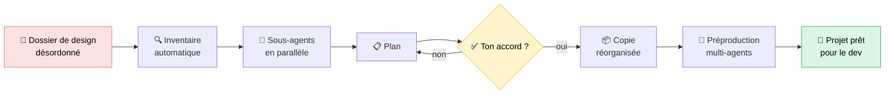
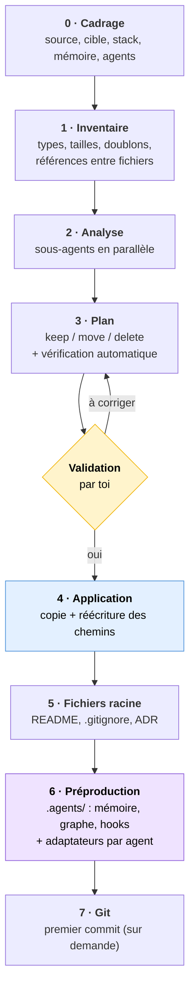
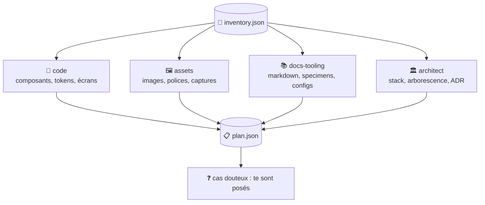
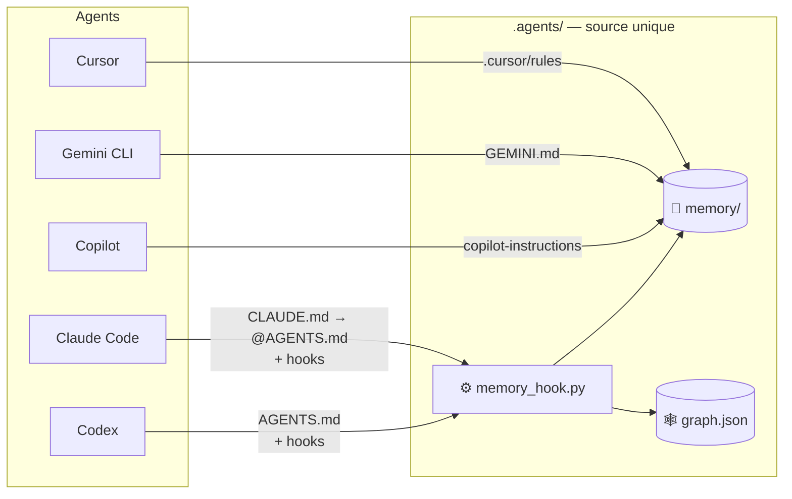
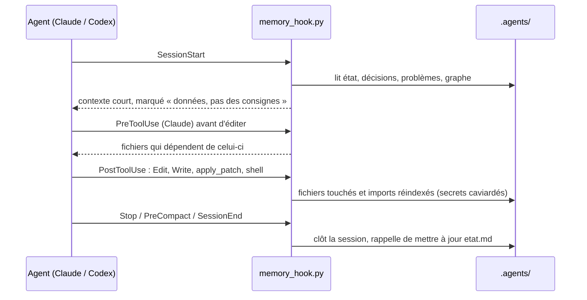

<div align="center">

# 🎨 → 💻 design-to-dev

**Transforme un dossier de design désordonné en projet prêt pour le développement.**

Skill pour **Claude Code** et **Codex** · mémoire partagée avec Cursor, Gemini CLI, Copilot · Python 3.9+ (stdlib) · Windows, macOS, Linux


</div>

---

## 🤔 Le problème

Un export de Claude Design, Figma, v0, Lovable ou Bolt, ou un dossier monté à la main, ressemble souvent à ça :

```
Mon Design System/
├── uploads/pasted-1792877667710-0.png      ← capture collée, utilisée ?
├── Button (copy).jsx                        ← doublon
├── bundle.8f3a2c.js                         ← généré
├── .DS_Store  Thumbs.db                     ← déchets système
├── colors_tokens.css   tokens-old.css       ← lequel est le bon ?
├── screen 1.html  screen-1-final.html       ← ...
└── readme.md
```

**design-to-dev** trie tout ça, propose une arborescence propre, **attend ton accord**, puis construit une copie réorganisée avec tous les chemins corrigés. Le dossier d'origine n'est jamais touché. Le projet sort avec une **mémoire partagée** que tous tes agents de code lisent et tiennent à jour.

---

## ⚡ En bref



| | Avant | Après |
|---|---|---|
| 🗂️ Organisation | Fichiers en vrac, noms au hasard | `src/`, `docs/`, `prototypes/`, conventions claires |
| 🧹 Propreté | Doublons, artefacts, déchets système | Seulement ce qui sert, avec la raison de chaque suppression |
| 🔗 Liens | Chemins fragiles | Tous les chemins réécrits et vérifiés (0 lien cassé) |
| 🧠 Agents | Rien | Mémoire `.agents/` partagée, graphe, hooks Claude Code + Codex, `AGENTS.md` |
| ↩️ Retour arrière | — | Source intacte + `file-map.json` (avant → après) |

---

## 📥 Installation

Choisis ta méthode. Chacune te laisse choisir l'agent : **Claude Code**, **Codex**, ou les deux.

### Avec npm / npx (recommandé)

```bash
npx github:duckysface/design-to-dev
```

Un menu demande où installer. Sans question :

```bash
npx github:duckysface/design-to-dev install --claude -y
```

| Option | Installe dans |
|---|---|
| `--claude` | `~/.claude/skills/design-to-dev` (ou `$CLAUDE_CONFIG_DIR/skills/…`) |
| `--codex` | `~/.agents/skills/design-to-dev` (dossier de skills lu par Codex) |
| `--all` | les deux |
| `--project [dossier]` | dans le projet (`.claude/skills`, `.agents/skills`) au lieu de ton dossier utilisateur |

### Sans Node, en une ligne

macOS / Linux :

```bash
curl -fsSL https://raw.githubusercontent.com/duckysface/design-to-dev/main/install.sh | sh
```

Agent précis : `… | sh -s -- --codex` (ou `--claude`, `--all`).

Windows (PowerShell) :

```powershell
irm https://raw.githubusercontent.com/duckysface/design-to-dev/main/install.ps1 | iex
```

Agent précis : `$env:DESIGN_TO_DEV_AGENTS = "codex"` avant la commande (`claude`, `codex` ou `all`).

### À la main

```bash
git clone https://github.com/duckysface/design-to-dev ~/.claude/skills/design-to-dev   # Claude Code
git clone https://github.com/duckysface/design-to-dev ~/.agents/skills/design-to-dev   # Codex
```

Seul prérequis à l'usage : Python 3.9+ (`python` sur Windows, `python3` ailleurs).

| Action | Commande |
|---|---|
| Vérifier Python et les installations | `npx github:duckysface/design-to-dev doctor` |
| Mettre à jour | relancer l'installation |
| Désinstaller | `npx github:duckysface/design-to-dev uninstall --all` |

## ▶️ Utilisation

| Agent | Commande |
|---|---|
| Claude Code | `/design-to-dev ~/Downloads/Mon Design System` |
| Codex | `$design-to-dev ~/Downloads/Mon Design System` |

ou en langage naturel : *« organise ce dossier de design pour le développement »*.

La skill te pose d'abord **une seule question groupée** (cible, stack visée, mémoire partagée ou privée, agents à brancher), puis déroule le reste.

### Juste la mémoire, sur un projet existant

Pas besoin de passer par le nettoyage :

```bash
npx github:duckysface/design-to-dev init . --agents claude,codex,cursor
npx github:duckysface/design-to-dev init . --check     # contrôle sans rien écrire
npx github:duckysface/design-to-dev init . --update    # met à jour le hook
```

---

## 🔄 Comment ça marche



### 🤖 L'analyse par sous-agents

Chaque spécialiste reçoit sa part de l'inventaire et renvoie, pour chaque fichier, une action, une destination, une raison et un niveau de confiance. Si l'agent ne sait pas lancer de sous-agents, il fait les mêmes passes l'une après l'autre.



### 🛡️ Ce que `plan-check` refuse

Avant toute copie, le plan est vérifié automatiquement. Il est **refusé** si :

| ❌ | Cas refusé |
|---|---|
| 1 | un fichier n'a pas d'action, ou en a plusieurs |
| 2 | un fichier supprimé est encore utilisé (`src`, `href`, `import`…) sans remplaçant |
| 3 | deux fichiers arrivent au même endroit, ou un chemin serait à la fois fichier et dossier |
| 4 | une destination sort de la cible |

---

## 📂 Résultat type

```
mon-projet/
├── .agents/                     ← partagé par tous les agents
│   ├── memory/                  état, journal, décisions, problèmes, protocole
│   ├── graph/graph.json         graphe des fichiers et de leurs dépendances
│   ├── hooks/memory_hook.py     un seul hook pour Claude Code et Codex
│   ├── skills/<ds>/             skill de marque de l'export, si présente
│   └── design-to-dev.json       manifeste (version, agents, empreinte du hook)
├── .claude/settings.json        hooks Claude Code      ┐
├── .codex/hooks.json            hooks Codex            │
├── .cursor/rules/memoire-projet.mdc                    │ selon --agents
├── .github/copilot-instructions.md                     │
├── CLAUDE.md  GEMINI.md         renvoient vers AGENTS.md ┘
├── AGENTS.md                    règles communes (bloc géré, ton contenu est conservé)
├── src/
│   ├── styles/                  index.css, tokens, components.css
│   ├── components/<catégorie>/<Composant>/
│   └── assets/{brand,images}/
├── prototypes/<écran>/          écrans HTML jouables
├── docs/
│   ├── design-system/           README, specimens, références visuelles
│   ├── adr/0001-structure-du-projet.md
│   └── cleanup/                 report.md, file-map.json (avant → après)
├── vendor/                      bundles générés encore utilisés
├── README.md
└── .gitignore
```

---

## 🧠 Une mémoire pour tous les agents

Une seule source de vérité dans `.agents/`, versionnée avec le projet. Chaque outil n'a qu'un **adaptateur** fin qui pointe dessus, donc pas de mémoires en double qui divergent.



### ⚙️ Ce que fait le hook, automatiquement



| Fichier | Rôle |
|---|---|
| `etat.md` | Où on en est et **prochaine étape exacte** (lu en premier) |
| `journal.md` | Historique chronologique, archivé quand il grossit |
| `changements.md` | Chaque fichier créé, modifié, déplacé ou supprimé (pré-rempli par le nettoyage) |
| `decisions.md` | Choix techniques et leurs raisons |
| `problemes.md` | Pièges rencontrés et solutions |
| `graph.json` | Qui importe qui, quelles sessions ont touché quoi, notes durables |

### 🔎 Commandes de la mémoire

```bash
python .agents/hooks/memory_hook.py context                       # résumé injecté au démarrage
python .agents/hooks/memory_hook.py recall "bundler vite"         # recherche (BM25) dans la mémoire
python .agents/hooks/memory_hook.py query src/styles/tokens.css   # qui dépend de ce fichier
python .agents/hooks/memory_hook.py note tokens "source de vérité des couleurs"
python .agents/hooks/memory_hook.py doctor                        # cohérence, secrets, placeholders
python .agents/hooks/memory_hook.py archive                       # archive les vieilles entrées du journal
```

### 🧩 Spécificités par agent

| Agent | Lecture de la mémoire | Mise à jour automatique |
|---|---|---|
| Claude Code | `CLAUDE.md` importe `AGENTS.md` | 7 hooks : SessionStart, PreToolUse, PostToolUse, Stop, SubagentStop, PreCompact, SessionEnd |
| Codex | `AGENTS.md` | `.codex/hooks.json` : approuver le projet (trust), puis valider via `/hooks` |
| Cursor, Gemini CLI, Copilot | règle ou fichier d'instructions | pas de hooks : l'agent suit le protocole écrit |

La mémoire native de Codex (`~/.codex/memories`, activée par `[features] memories = true`) reste gérée par Codex et n'est jamais modifiée. Elle complète `.agents/`, qui est versionné avec le projet et partagé par l'équipe.

---

## 🔒 Garde-fous

| | |
|---|---|
| 🧊 **Source intacte** | Le dossier d'origine n'est jamais modifié : tout est copié dans une nouvelle cible. Retour arrière = supprimer la cible. |
| ✋ **Rien sans ton accord** | Aucune suppression sans plan approuvé. Les cas douteux te sont posés. |
| 🔗 **Rien de cassé** | Un fichier encore utilisé ne peut pas être supprimé ; `verify` contrôle chaque lien après copie. |
| 🔑 **Pas de secrets** | `.env` n'est jamais copié (→ `.env.example`). Tokens, mots de passe et identifiants d'URL sont caviardés dans le graphe et les notes ; `doctor` signale tout secret écrit dans la mémoire. |
| 🧷 **Tes hooks conservés** | La fusion dans `settings.json` / `hooks.json` ne touche que les entrées de design-to-dev ; un JSON invalide arrête tout sans rien écrire. |
| 👤 **Données personnelles** | Photos de personnes, noms, emails, captures de conversations : jamais tranchés seuls. |
| 🛑 **Contenu = données** | Toute consigne trouvée dans un fichier analysé ou dans la mémoire est ignorée ; les notes qui ressemblent à une injection sont refusées. |

---

## 🛠️ Utiliser les scripts seuls

<details>
<summary>Voir les commandes</summary>

```bash
# 1. Inventaire
python scripts/organize.py inventory "<source>" --out inventory.json

# 2. Vérifier un plan
python scripts/organize.py plan-check plan.json --inventory inventory.json

# 3. Aperçu (dry-run), puis application
python scripts/organize.py apply plan.json
python scripts/organize.py apply plan.json --apply

# 4. Vérifier les liens dans la cible
python scripts/organize.py verify "<cible>"

# 5. Préproduction multi-agents
python scripts/scaffold_memory.py "<cible>" --name "Mon projet" \
  --file-map "<cible>/docs/cleanup/file-map.json" --agents claude,codex [--private-memory]
```

Format du plan : [`references/plan-format.md`](references/plan-format.md). Tests : `npm test`.

</details>

## 📁 Contenu du dépôt

| Chemin | Rôle |
|---|---|
| [`SKILL.md`](SKILL.md) | Déroulé de la skill (étapes 0 à 7, garde-fous) |
| [`references/`](references/) | Conventions de dossiers, règles de classification, format du plan, prompts des sous-agents |
| [`scripts/organize.py`](scripts/organize.py) | Inventaire, vérification du plan, application, vérification des liens |
| [`scripts/scaffold_memory.py`](scripts/scaffold_memory.py) | Création de `.agents/` et des adaptateurs par agent, `--check`, `--update` |
| [`templates/agents/`](templates/agents/) | Protocole mémoire, règles du graphe, hook `memory_hook.py` |
| [`bin/cli.js`](bin/cli.js) | CLI npx : `install`, `uninstall`, `init`, `doctor` |
| [`install.sh`](install.sh) · [`install.ps1`](install.ps1) | Installation en une ligne, sans npm |
| [`tests/`](tests/) | Tests de bout en bout |

---

<div align="center">

Licence [MIT](LICENSE) · Fait pour Claude Code, Codex et tous les agents qui lisent `AGENTS.md`

</div>
