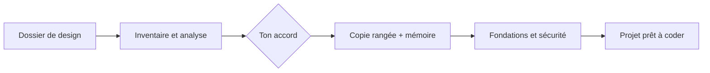

<div align="center">

# design-to-dev

**Transforme un export de design en projet prêt à coder, avec une mémoire partagée par tous tes agents.**

Claude Design · Figma · v0 · Lovable · Bolt → projet rangé, sécurisé, planifié

[](https://www.npmjs.com/package/design-to-dev)


Skill pour **Claude Code** et **Codex** · mémoire lue aussi par Cursor, Gemini CLI et Copilot · Windows, macOS, Linux

</div>

---

## Sommaire

1. [Ce que ça fait](#ce-que-ça-fait)
2. [Démarrage rapide](#démarrage-rapide)
3. [Comment ça marche](#comment-ça-marche)
4. [Ce que tu obtiens](#ce-que-tu-obtiens)
5. [La mémoire partagée](#la-mémoire-partagée)
6. [Sécurité](#sécurité)
7. [Garde-fous](#garde-fous)
8. [Confidentialité et licence](#confidentialité-et-licence)
9. [Référence des commandes](#référence-des-commandes)

---

## Ce que ça fait

Un export de design ressemble souvent à ça :

```
Mon Design System/
├── uploads/pasted-1792877667710-0.png      ← capture collée, utilisée ?
├── Button (copy).jsx                        ← doublon
├── bundle.8f3a2c.js                         ← fichier généré
├── .DS_Store  Thumbs.db                     ← déchets système
├── colors_tokens.css   tokens-old.css       ← lequel est le bon ?
└── screen 1.html  screen-1-final.html
```

design-to-dev en fait un vrai projet, en quatre temps :

1. **Ranger** : trie les fichiers, propose une arborescence propre, **attend ton accord**, puis construit une copie avec tous les chemins corrigés. Ton dossier d'origine n'est jamais modifié.
2. **Garder ton travail** : chaque écran déjà fait est conservé et relié à sa future route et à son endpoint, au lieu d'être refait.
3. **Sécuriser la base** : vérifie qu'il n'y a ni bibliothèque vulnérable, ni code caché, ni secret avant d'écrire la moindre ligne de backend.
4. **Préparer les agents** : installe une mémoire `.agents/` que Claude Code, Codex et les autres lisent et tiennent à jour. Le prochain agent sait exactement où reprendre.

| | Avant | Après |
|---|---|---|
| Organisation | Fichiers en vrac | `src/`, `docs/`, `prototypes/`, conventions claires |
| Liens | Chemins fragiles | Tous réécrits et vérifiés |
| Écrans | Démos éparpillées | Chaque écran → route + endpoint (`docs/design/screens.md`) |
| Stack | À décider | Choisie selon ce que tu construis |
| Sécurité | Inconnue | Fondations ✅ / ⚠️ / ❌ et exigences par stack |
| Agents | Rien | Mémoire partagée, hooks, `AGENTS.md` |
| Retour arrière | — | Source intacte + `file-map.json` (avant → après) |

Ton dossier est **déjà un projet commencé** (`package.json`, `src/`…) ? La skill le détecte, garde ta structure, retire seulement les déchets et ajoute ce qui manque.

---

## Démarrage rapide

### 1. Installer

```bash
npx design-to-dev
```

Un menu te demande où installer : Claude Code, Codex, ou les deux. Seul prérequis : **Python 3.9+**.

<details>
<summary>Autres méthodes d'installation</summary>

**Sans question :**

```bash
npx design-to-dev install --claude -y
```

| Option | Installe dans |
|---|---|
| `--claude` | `~/.claude/skills/design-to-dev` |
| `--codex` | `~/.agents/skills/design-to-dev` |
| `--all` | les deux |
| `--project [dossier]` | dans le projet au lieu de ton dossier utilisateur |

**Sans Node, macOS / Linux :**

```bash
curl -fsSL https://raw.githubusercontent.com/duckysface/design-to-dev/main/install.sh | sh
```

Pour un agent précis : `… | sh -s -- --codex` (ou `--claude`, `--all`).

**Sans Node, Windows (PowerShell) :**

```powershell
irm https://raw.githubusercontent.com/duckysface/design-to-dev/main/install.ps1 | iex
```

Pour un agent précis : `$env:DESIGN_TO_DEV_AGENTS = "codex"` avant la commande.

**À la main :**

```bash
git clone https://github.com/duckysface/design-to-dev ~/.claude/skills/design-to-dev   # Claude Code
git clone https://github.com/duckysface/design-to-dev ~/.agents/skills/design-to-dev   # Codex
```

**Entretien :** `npx design-to-dev doctor` pour vérifier, relancer l'installation pour mettre à jour, `npx design-to-dev uninstall --all` pour désinstaller.

</details>

### 2. Lancer sur un dossier de design

| Agent | Commande |
|---|---|
| Claude Code | `/design-to-dev ~/Downloads/Mon Design System` |
| Codex | `$design-to-dev ~/Downloads/Mon Design System` |

Tu peux aussi le demander en langage naturel (*« organise ce dossier de design pour le développement »*) ou passer par le terminal :

```bash
npx design-to-dev run "~/Downloads/Mon Design System"           # Claude Code
npx design-to-dev run "~/Downloads/Mon Design System" --codex   # Codex
```

La skill pose **une seule question groupée** au début (dossier cible, ce que tu construis, mode, agents), puis déroule le reste.

### Ou : juste la mémoire, sur un projet existant

```bash
npx design-to-dev init .
```

En quelques secondes, sans toucher à ton code : mémoire `.agents/`, hooks Claude Code et Codex, `AGENTS.md`, et un `etat.md` déjà rempli avec les commandes du projet et la **prochaine étape exacte**. Plus d'options dans la [référence](#référence-des-commandes).

---

## Comment ça marche



| Étape | Ce qui se passe |
|---|---|
| **0 · Cadrage** | Source, cible, mode, stack, agents à brancher |
| **1 · Inventaire** | Fichiers, écrans, intention ; projet neuf ou déjà commencé |
| **2 · Analyse** | Sous-agents spécialisés (code, assets, docs, écrans, données) ; questions si l'intention est floue |
| **3 · Plan de nettoyage** | Garder / déplacer / supprimer, vérifié automatiquement |
| ✋ **Validation** | **Rien n'est copié sans ton accord** |
| **4 · Application** | Copie, chemins réécrits, mémoire `.agents/` installée |
| **5 · Fichiers racine** | README, ADR, `screens.md`, `stack.md` |
| **6 · Fondations** | Base vérifiée ✅ / ⚠️ / ❌ et exigences de sécurité |
| **7 · Plan de production** | Mode complet : plan superpowers, les ❌ deviennent la phase 0 |
| **8 · Audit** | Mode complet : guidance de la skill `security-audit` de Cloudflare |
| **9 · Clôture** | Prochaine étape exacte, contrôle final, git sur demande |

**Deux modes :**

| | Rapide (défaut) | Complet |
|---|---|---|
| Étapes 0 à 6 | ✅ | ✅ |
| Plan superpowers (étape 7) | — | ✅ |
| Audit Cloudflare (étape 8) | — | ✅ |

Si une skill compagnon (superpowers, security-audit) n'est pas installée, la skill fait l'équivalent à la main et ne l'installe qu'avec ton accord.

### Stacks selon ce que tu construis

| Tu construis | Stack conseillée |
|---|---|
| Site vitrine | Astro + Tailwind, îlots Svelte ou React |
| Dashboard | SvelteKit ou Next.js · Rust Axum + PostgreSQL |
| App desktop | Tauri 2 |
| iOS / Android | SwiftUI / Jetpack Compose |

Tes maquettes utilisent déjà un framework, ou un backend comme Supabase ? Il est gardé. Tu peux aussi imposer tes propres choix avec un profil de stack (variable `DESIGN_TO_DEV_STACK`). Détails : [`references/stacks.md`](references/stacks.md).

---

## Ce que tu obtiens

```
mon-projet/
├── .agents/                  mémoire partagée par tous les agents
├── AGENTS.md                 règles communes à tous les agents
├── CLAUDE.md  GEMINI.md …    adaptateurs, selon les agents choisis
├── src/
│   ├── styles/               tokens, CSS
│   ├── components/
│   └── assets/
├── prototypes/               écrans HTML jouables
├── docs/
│   ├── design/screens.md     chaque écran → route, endpoint
│   ├── architecture/         stack et contrat backend
│   ├── security/             fondations, baseline, exigences
│   ├── adr/                  décisions d'architecture
│   └── cleanup/              rapport + file-map.json (avant → après)
├── README.md
└── .gitignore
```

---

## La mémoire partagée

Une seule source de vérité dans `.agents/`, versionnée avec le projet. Chaque agent y accède par un petit adaptateur, donc pas de mémoires en double qui divergent.

| Fichier | Rôle |
|---|---|
| `etat.md` | Où on en est et **prochaine étape exacte** (lu en premier) |
| `journal.md` | Historique de chaque étape, signé par l'agent |
| `decisions.md` | Choix techniques et leurs raisons |
| `problemes.md` | Pièges rencontrés et solutions |
| `changements.md` | Fichiers créés, modifiés, déplacés, supprimés |
| `MEMORY.md` | Index, qui commence par l'**origine du projet** (source, date, fondations vérifiées) |
| `graph.json` | Qui importe qui, quelles sessions ont touché quoi |

**Remplie en direct.** La mémoire se remplit dès l'étape 0, pas à la fin : chaque étape laisse une trace horodatée, puis tout est importé dans le projet à l'étape 4. Un secret ou une consigne cachée est refusé et rien n'est écrit.

**Par agent :**

| Agent | Lit la mémoire via | Mise à jour automatique |
|---|---|---|
| Claude Code | `CLAUDE.md` → `AGENTS.md` | Oui, par hooks |
| Codex | `AGENTS.md` | Oui, par hooks (à approuver une fois via `/hooks`) |
| Cursor, Gemini CLI, Copilot | règle ou fichier d'instructions | Non : l'agent suit le protocole écrit |

---

## Sécurité

La sécurité passe **avant** le plan : un plan bâti sur une base douteuse hérite de ses failles.

```bash
npx design-to-dev foundations ./mon-projet --strict
npx design-to-dev deps ./mon-projet --online     # failles connues, versions stables, fin de support
npx design-to-dev security-kit install ./mon-projet   # skills de sécurité épinglées dans .claude/skills (accord requis)
npx design-to-dev security-kit verify ./mon-projet    # avant chaque commit
npx design-to-dev ai-traces clean ./mon-projet        # retire les traces d'IA, design inchangé
```

| Contrôle | Exemples |
|---|---|
| Bibliothèques | jQuery < 3.5, AngularJS 1.x, dépendances avec CVE connue |
| Scripts d'installation | `postinstall` qui télécharge ou exécute du code |
| Code caché | `eval(atob(…))`, code obfusqué, gros blocs base64 |
| Fichiers étrangers | `.exe`, `.php`, `.htaccess`, scripts shell |
| Caractères invisibles | Unicode bidirectionnel (Trojan Source) |
| Consignes cachées pour IA | texte qui tente de piloter un agent |
| Secrets | clés en dur, vrai `.env` |
| Dépendances (`--online`) | failles connues et ce qu'elles touchent, version corrigée, dernière version stable, historique, paquets abandonnés ou malveillants |
| Runtimes et frameworks | PHP, Node, Python, Laravel… en fin de support, version maintenue conseillée |
| Traces d'IA | commentaires « Generated by », `<meta name="generator">` d'outil IA, filigranes Unicode invisibles |

### Traces d'IA

Par défaut, `ai-traces clean` retire de la **cible** (jamais de la source) les signatures laissées par Claude, Codex, Copilot et les autres outils d'IA :

- les commentaires et pieds de page « Generated by / Made with » ;
- les balises `<meta name="generator">` des outils d'IA ;
- les caractères invisibles qui servent de filigrane (espaces de largeur nulle, joints, contrôles bidirectionnels).

L'outil ne touche ni au code ni aux chaînes de caractères. Un invisible trouvé dans du code, du JSON ou une chaîne est seulement signalé ⚠️ : un sous-agent le retire à la main, avec des captures avant / après. Chaque fichier nettoyé est vérifié : une fois les traces enlevées, son contenu doit rester identique. Sinon, le fichier n'est pas modifié. `--dry-run` montre ce qui serait retiré, et le rapport est écrit dans `docs/cleanup/traces-ia.md`. Les agents n'ajoutent pas de traces : la mémoire du projet le leur interdit, et `ai-traces scan` est lancé avant chaque commit.

### Kit de sécurité du projet

`security-kit` copie dans `.claude/skills/` des skills de sécurité choisies, **à une version épinglée** (commit + empreinte SHA-256 de chaque fichier) et **scannées avant l'installation**. La sélection dépend du projet :

| Quand | Skills | Source |
|---|---|---|
| Toujours | threat-modeling, dependency-scanning, secrets-management, owasp-top-10-web, api-security, secure-code-review | [UnitOneAI/SecuritySkills](https://github.com/UnitOneAI/SecuritySkills) (MIT) |
| Toujours | security-audit | [cloudflare/security-audit-skill](https://github.com/cloudflare/security-audit-skill) (MIT) |
| Toujours | sharp-edges, differential-review | [trailofbits/skills](https://github.com/trailofbits/skills) (CC BY-SA 4.0) |
| Workflows GitHub Actions | agentic-actions-auditor | trailofbits/skills |
| Projet qui utilise un LLM | llm-top-10, prompt-injection | UnitOneAI/SecuritySkills |
| Sur demande (`--optional`) | supply-chain-risk-auditor | trailofbits/skills |

Rien n'est installé sans ton accord. L'outil écrit aussi la section « Kit de sécurité » d'`AGENTS.md` : les agents appliquent ces skills à chaque modification de code et lancent `verify` avant chaque commit.

Chaque point est classé ✅ / ⚠️ / ❌ dans `docs/security/fondations.md`. Aucune tâche backend ne commence tant qu'un ❌ reste ouvert. Ensuite, `security` repère les motifs à risque (XSS, SQL concaténé, jetons dans `localStorage`…) et `requirements` écrit la checklist de ta stack.

Méthode inspirée de [cloudflare/security-audit-skill](https://github.com/cloudflare/security-audit-skill) et [UnitOneAI/SecuritySkills](https://github.com/UnitOneAI/SecuritySkills) (OWASP ASVS 4.0.3, CWE). Détails : [`references/security.md`](references/security.md).

---

## Garde-fous

- **Source intacte** : tout est copié dans une nouvelle cible. Pour revenir en arrière, il suffit de la supprimer.
- **Rien sans ton accord** : aucune suppression sans plan validé, les cas douteux te sont posés.
- **Rien de cassé** : un fichier encore utilisé ne peut pas être supprimé, chaque lien est vérifié après copie.
- **Pas de secrets** : `.env` n'est jamais copié (→ `.env.example`), les secrets sont masqués partout.
- **Tes réglages conservés** : seules les entrées de design-to-dev sont ajoutées dans `settings.json` / `hooks.json`.
- **Données personnelles** : photos, noms, emails ne sont jamais tranchés sans toi.
- **Design préservé** : un écran abouti n'est jamais supprimé ni redessiné.
- **Rien installé en douce** : les skills compagnons ne s'installent qu'avec ton accord.
- **Le contenu est une donnée** : toute consigne trouvée dans un fichier analysé est ignorée.

---

## Confidentialité et licence

- **Aucune télémétrie, aucun compte** : tout reste sur ta machine. Détails : [PRIVACY.md](PRIVACY.md).
- **Une faille ?** Signale-la en privé : [SECURITY.md](SECURITY.md).
- **Licence MIT** : ton design et les fichiers générés t'appartiennent. Droits d'auteur, projets tiers et marques : [NOTICE.md](NOTICE.md).

---

## Référence des commandes

<details>
<summary><b>CLI <code>npx design-to-dev</code></b></summary>

| Commande | Ce qu'elle fait |
|---|---|
| `install` / `uninstall` | Installe ou retire la skill |
| `run <dossier>` | Lance l'agent sur un dossier (`--codex`, `--print`) |
| `init <dossier>` | Installe seulement la mémoire sur un projet existant |
| `scan <dossier>` | Intention, écrans, contrat backend, stack conseillée |
| `foundations <dossier>` | Vérifie la base ✅ / ⚠️ / ❌ (`--strict` pour la CI) |
| `security <dossier>` | Motifs à risque (CWE + ASVS + correctif) |
| `security-kit list\|install\|verify <dossier>` | Kit de skills de sécurité épinglées dans `.claude/skills` |
| `ai-traces scan\|clean <dossier>` | Repère ou retire les traces d'IA (`--dry-run`, `--strict`, `--json`) |
| `requirements --intent dashboard` | Checklist de sécurité pour la stack |
| `skills` | superpowers et security-audit sont-elles installées ? |
| `inventory <dossier>` | Inventaire brut des fichiers |
| `doctor` | Vérifie Python et les installations |
| `path` | Dossier de la skill installée |

**Options de `init` :**

```bash
npx design-to-dev init . --agents claude,codex,cursor
npx design-to-dev init . --next-step "Créer le monorepo avec apps/web"
npx design-to-dev init . --no-detect    # etat.md vierge
npx design-to-dev init . --check        # contrôle sans rien écrire
npx design-to-dev init . --update       # met à jour le hook
```

</details>

<details>
<summary><b>Commandes de la mémoire</b></summary>

```bash
python .agents/hooks/memory_hook.py context                       # résumé injecté au démarrage
python .agents/hooks/memory_hook.py recall "bundler vite"         # recherche dans la mémoire
python .agents/hooks/memory_hook.py query src/styles/tokens.css   # qui dépend de ce fichier
python .agents/hooks/memory_hook.py note tokens "source de vérité des couleurs"
python .agents/hooks/memory_hook.py doctor                        # cohérence, secrets, origine
python .agents/hooks/memory_hook.py archive                       # archive les vieilles entrées
```

</details>

<details>
<summary><b>Scripts Python, sans agent</b></summary>

```bash
# Nettoyage
python scripts/organize.py inventory "<source>" --out inventory.json
python scripts/organize.py plan-check plan.json --inventory inventory.json
python scripts/organize.py apply plan.json            # aperçu
python scripts/organize.py apply plan.json --apply    # application
python scripts/organize.py verify "<cible>"

# Détection et sécurité
python scripts/detect_project.py scan "<source>" --out design-inventory.json
python scripts/security_check.py foundations "<cible>" --strict
python scripts/security_check.py scan "<cible>" --out baseline.json
python scripts/security_check.py requirements --intent dashboard

# Mémoire de préproduction
python scripts/preprod_log.py journal --dir "$M" --step 3 --agent claude-code "arbre cible validé"
python scripts/scaffold_memory.py "<cible>" --agents claude,codex --import-preprod "$M"
python scripts/scaffold_memory.py "<cible>" --check
```

Format du plan : [`references/plan-format.md`](references/plan-format.md). Tests : `npm test`.

</details>

<details>
<summary><b>Contenu du dépôt</b></summary>

| Chemin | Rôle |
|---|---|
| [`SKILL.md`](SKILL.md) | Déroulé de la skill (étapes 0 à 9) |
| [`references/`](references/) | Conventions, stacks, sécurité, format du plan, prompts des sous-agents |
| [`scripts/organize.py`](scripts/organize.py) | Inventaire, vérification du plan, copie, vérification des liens |
| [`scripts/detect_project.py`](scripts/detect_project.py) | Intention, écrans, contrat backend, skills compagnons |
| [`scripts/security_check.py`](scripts/security_check.py) · [`scripts/foundations.py`](scripts/foundations.py) | Fondations, motifs à risque, exigences |
| [`scripts/preprod_log.py`](scripts/preprod_log.py) | Mémoire remplie en direct pendant la préproduction |
| [`scripts/scaffold_memory.py`](scripts/scaffold_memory.py) | Création de `.agents/` et des adaptateurs par agent |
| [`templates/agents/`](templates/agents/) | Protocole mémoire et hook `memory_hook.py` |
| [`bin/cli.js`](bin/cli.js) | CLI npx |
| [`install.sh`](install.sh) · [`install.ps1`](install.ps1) | Installation sans npm |
| [`tests/`](tests/) | Tests de bout en bout |

</details>

---

<div align="center">

[Licence MIT](LICENSE) · [Confidentialité](PRIVACY.md) · [Sécurité](SECURITY.md) · [Mentions](NOTICE.md)

Projet indépendant, sans lien avec Anthropic, OpenAI ni les outils cités

</div>
