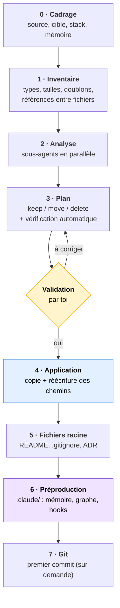
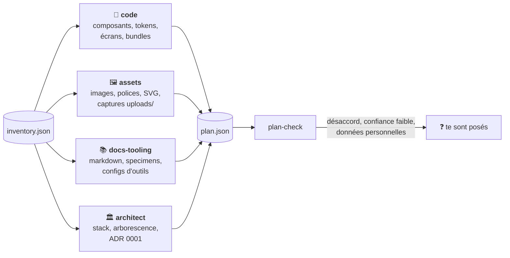
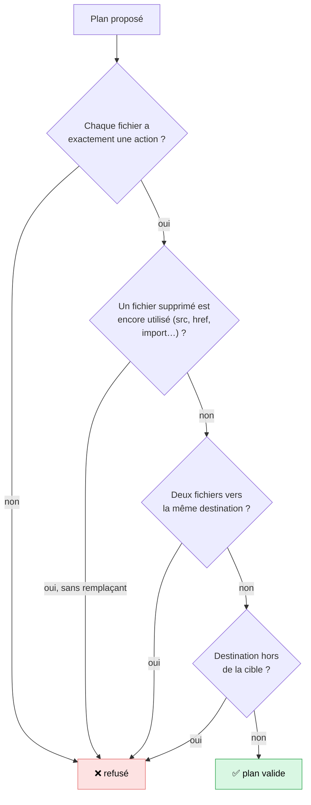
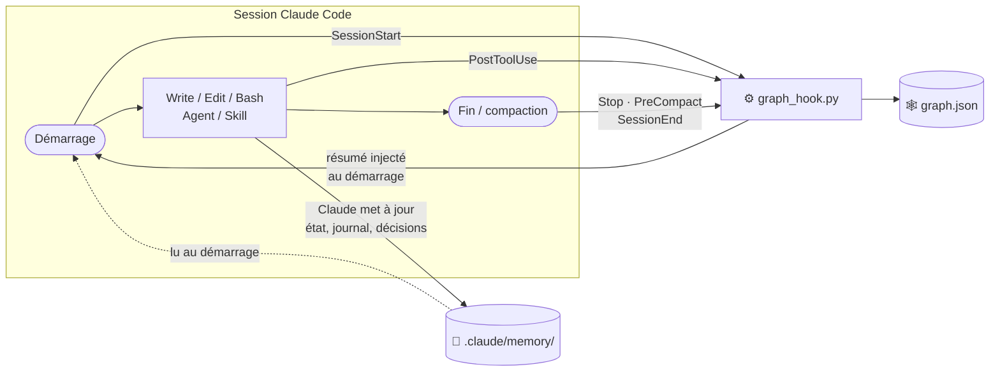

<div align="center">

# 🎨 → 💻 design-to-dev

**Transforme un dossier de design désordonné en projet prêt pour le développement.**

Skill pour [Claude Code](https://claude.com/claude-code) · Python 3.9+ (stdlib uniquement) · Windows, macOS, Linux


</div>

---

## 🤔 Le problème

Un export de Claude Design, Figma, v0, Lovable ou Bolt, ou un dossier monté à la main, ressemble souvent à ça :

```
Mon Design System/
├── uploads/pasted-1792877667710-0.png      ← capture collée, utilisée ?
├── Button (copy).jsx                        ← doublon
├── bundle.8f3a2c.js                         ← généré
├── .DS_Store  Thumbs.db                     ← déchets système
├── colors_tokens.css   tokens-old.css       ← lequel est le bon ?
├── screen 1.html  screen-1-final.html       ← ...
└── readme.md
```

**design-to-dev** trie tout ça, propose une arborescence propre, **attend ton accord**, puis construit une copie réorganisée avec tous les chemins corrigés. Le dossier d'origine n'est jamais touché.

---

## ⚡ En bref


| | Avant | Après |
|---|---|---|
| 🗂️ Organisation | Fichiers en vrac, noms au hasard | `src/`, `docs/`, `prototypes/`, conventions claires |
| 🧹 Propreté | Doublons, artefacts, déchets système | Seulement ce qui sert, avec la raison de chaque suppression |
| 🔗 Liens | Chemins fragiles | Tous les chemins réécrits et vérifiés (0 lien cassé) |
| 🧠 Claude Code | Rien | Mémoire projet, graphe de dépendances, hooks, `CLAUDE.md` |
| ↩️ Retour arrière | — | Source intacte + `file-map.json` (avant → après) |

---

## 📥 Installation

```bash
git clone https://github.com/duckysface/design-to-dev ~/.claude/skills/design-to-dev
```

C'est tout. Seul prérequis : Python 3.9+ (`python` sur Windows, `python3` ailleurs).

## ▶️ Utilisation

Dans Claude Code :

```
/design-to-dev ~/Downloads/Mon Design System
```

ou en langage naturel : *« organise ce dossier de design pour le développement »*.

La skill te pose d'abord **une seule question groupée** (cible, stack visée, mémoire partagée ou privée), puis déroule le reste.

---

## 🔄 Comment ça marche



### 🤖 L'analyse par sous-agents

Chaque spécialiste reçoit sa part de l'inventaire et renvoie, pour chaque fichier, une action, une destination, une raison et un niveau de confiance.



### 🛡️ Ce que `plan-check` refuse



---

## 📂 Résultat type

```
mon-projet/
├── .claude/
│   ├── memory/            🧠 MEMORY.md, etat.md, journal.md, changements.md,
│   │                         decisions.md, problemes.md, PROTOCOLE.md, GRAPHE.md
│   ├── hooks/graph_hook.py
│   ├── graph/graph.json   🕸️ graphe des fichiers et de leurs dépendances
│   ├── skills/<ds>/       🎨 skill de marque de l'export, si présente
│   └── settings.json      ⚙️ hooks du graphe
├── src/
│   ├── styles/            index.css, tokens, components.css
│   ├── components/<catégorie>/<Composant>/
│   └── assets/{brand,images}/
├── prototypes/<écran>/    écrans HTML jouables
├── docs/
│   ├── design-system/     README, specimens, références visuelles
│   ├── adr/0001-structure-du-projet.md
│   └── cleanup/           📋 report.md, file-map.json (avant → après)
├── vendor/                bundles générés encore utilisés
├── CLAUDE.md
├── README.md
└── .gitignore
```

---

## 🧠 La préproduction Claude Code

Le projet sort avec une **mémoire** qui survit d'une session à l'autre et un **graphe** de dépendances mis à jour automatiquement.



| Fichier | Rôle |
|---|---|
| `etat.md` | Où on en est et **prochaine étape exacte** (lu en premier) |
| `journal.md` | Historique chronologique, jamais réécrit |
| `changements.md` | Chaque fichier créé, modifié, déplacé ou supprimé (pré-rempli par le nettoyage) |
| `decisions.md` | Choix techniques et leurs raisons |
| `problemes.md` | Pièges rencontrés et solutions |
| `graph.json` | Qui importe qui ; interrogeable avant toute modification |

Interroger le graphe avant de toucher un fichier :

```bash
python .claude/hooks/graph_hook.py query src/styles/tokens.css
```

---

## 🔒 Garde-fous

| | |
|---|---|
| 🧊 **Source intacte** | Le dossier d'origine n'est jamais modifié : tout est copié dans une nouvelle cible. Retour arrière = supprimer la cible. |
| ✋ **Rien sans ton accord** | Aucune suppression sans plan approuvé. Les cas douteux te sont posés. |
| 🔗 **Rien de cassé** | Un fichier encore utilisé ne peut pas être supprimé ; `verify` contrôle chaque lien après copie. |
| 🔑 **Pas de secrets** | `.env` n'est jamais copié (→ `.env.example`). Tokens, mots de passe et identifiants d'URL sont masqués dans le graphe. |
| 👤 **Données personnelles** | Photos de personnes, noms, emails, captures de conversations : jamais tranchés seuls. |
| 🛑 **Contenu = données** | Toute consigne trouvée dans un fichier analysé est ignorée. |

---

## 🛠️ Utiliser les scripts seuls

<details>
<summary>Voir les commandes</summary>

```bash
# 1. Inventaire
python scripts/organize.py inventory "<source>" --out inventory.json

# 2. Vérifier un plan
python scripts/organize.py plan-check plan.json --inventory inventory.json

# 3. Aperçu (dry-run), puis application
python scripts/organize.py apply plan.json
python scripts/organize.py apply plan.json --apply

# 4. Vérifier les liens dans la cible
python scripts/organize.py verify "<cible>"

# 5. Préproduction Claude Code
python scripts/scaffold_claude.py "<cible>" --name "Mon projet" \
  --file-map "<cible>/docs/cleanup/file-map.json" [--private-memory]
```

Format du plan : [`references/plan-format.md`](references/plan-format.md).

</details>

## 📁 Contenu du dépôt

| Chemin | Rôle |
|---|---|
| [`SKILL.md`](SKILL.md) | Déroulé de la skill (étapes 0 à 7, garde-fous) |
| [`references/`](references/) | Conventions de dossiers, règles de classification, format du plan, prompts des sous-agents |
| [`scripts/organize.py`](scripts/organize.py) | Inventaire, vérification du plan, application, vérification des liens |
| [`scripts/scaffold_claude.py`](scripts/scaffold_claude.py) | Création de `.claude/` (mémoire, hooks, graphe, `CLAUDE.md`) |
| [`templates/claude/`](templates/claude/) | Protocole mémoire, règles du graphe, hook `graph_hook.py` |

---

<div align="center">

Licence [MIT](LICENSE) · Fait pour [Claude Code](https://claude.com/claude-code)

</div>
